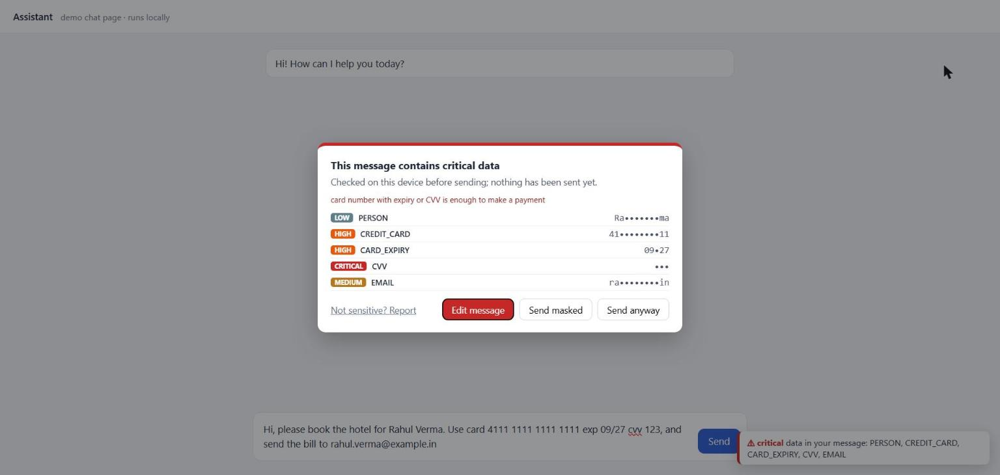
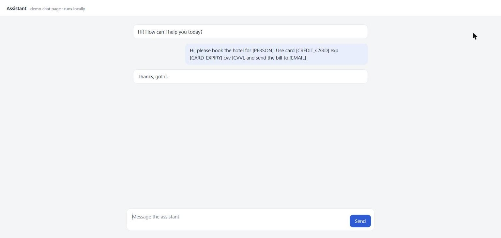
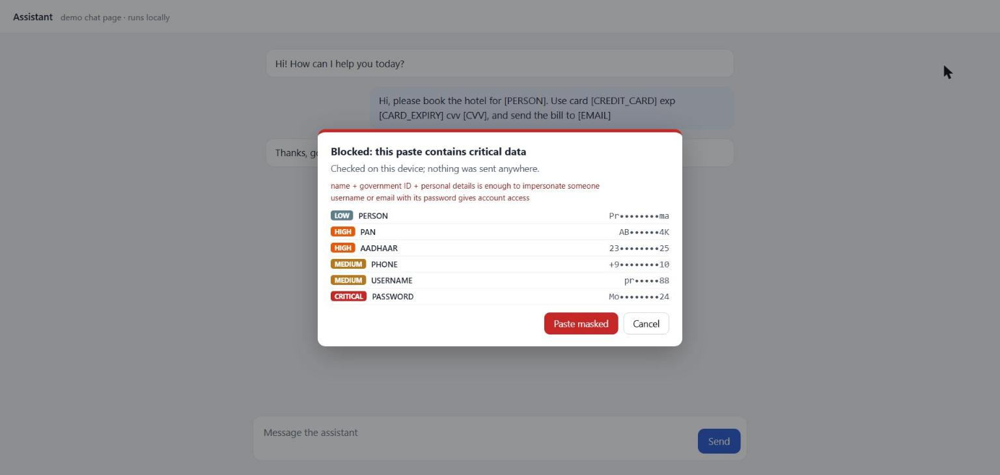
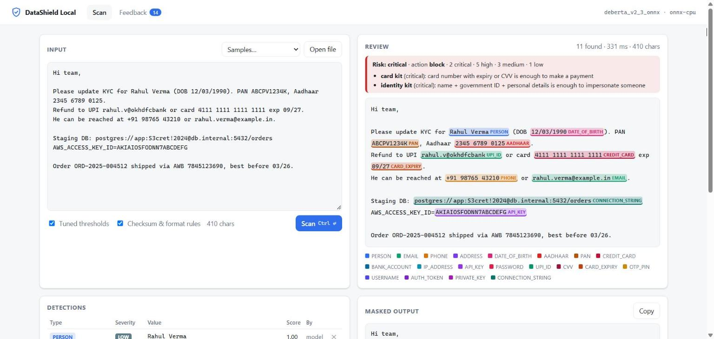

# DataShield Local

A local detection engine that finds personal data, Indian IDs, payment data and secrets
before they leak: in text you paste into AI tools, in files on your disk, in uploads.
**Everything runs on your own device.** No text, file or finding is sent anywhere.

- **Model:** DeBERTa-v3 token classifier (ONNX, CPU), 20 labels, plus checksum and format rules
  (Verhoeff for Aadhaar, Luhn for cards, mod-97 for IBAN, secret prefixes for keys).
- **Policy:** severity and action per label (block / mask / warn / allow) and combinations that
  are worse together (card + CVV, name + Aadhaar + DOB), in an editable `policy.yaml`.
- **Clients:** a review web app, a file and folder scanner, a Chrome / Edge extension.

**Product page:** [huggingface.co/spaces/aniketClaude/datashield-local](https://huggingface.co/spaces/aniketClaude/datashield-local) ·
**Model:** [aniketClaude/datashield-local-v2.3](https://huggingface.co/aniketClaude/datashield-local-v2.3)

| Send check in a chat | Sent masked |
|---|---|
|  |  |
| **Paste check** | **Review app** |
|  |  |

All values in the screenshots are made up; they were taken on the local demo chat page
(`http://127.0.0.1:8765/ext-test/demo`).

| Group | Labels |
|---|---|
| Personal | PERSON, EMAIL, PHONE, ADDRESS, DATE_OF_BIRTH, USERNAME, IP_ADDRESS |
| Indian IDs | AADHAAR, PAN |
| Financial | CREDIT_CARD, CARD_EXPIRY, CVV, BANK_ACCOUNT (incl. IBAN), UPI_ID, OTP_PIN |
| Credentials | PASSWORD, API_KEY, AUTH_TOKEN, PRIVATE_KEY, CONNECTION_STRING |

## Quick start

```bash
pip install "datashield-local @ git+https://github.com/agarje02/data_shield_local"   # PyPI release soon
datashield-local download-model  # once, ~740 MB, checksum-verified
datashield-local                    # engine + review app on http://127.0.0.1:8765
```

Scan files and folders (text, code, logs, CSV, JSON, PDF, Word, Excel, e-mail, zip):
```bash
datashield-local scan ~/Downloads --html report.html   # findings with file, line / page / sheet!cell
```
Values in reports are masked (`41••••••••11`) unless you pass `--show-values`. The exit code is 2
when anything critical is found, so the scanner fits into scripts and CI.

### Browser extension (Chrome, Edge)
Checks pastes, drops, file uploads and sent messages on ChatGPT, Claude, Gemini, Copilot and Gmail.
1. Keep the engine running (`datashield-local`).
2. `datashield-local install-native-host` once (lets the extension reach the engine; per user).
3. Install the extension (store link soon; until then `chrome://extensions` → Developer mode →
   Load unpacked → the `extension/` folder of this repo).

Details: [extension/README.md](extension/README.md).

## How it decides

```
text / file ─► extract (PDF, Office, zip, e-mail ...) ─► model + checksum rules ─► policy
                                                          (spans + scores)         (severity, action,
                                                                                    combos, risk)
```

| Severity | Labels (default policy) | Default action |
|---|---|---|
| critical | CVV, OTP_PIN, PASSWORD, PRIVATE_KEY, CONNECTION_STRING, API_KEY, AUTH_TOKEN | block |
| high | CREDIT_CARD, CARD_EXPIRY, BANK_ACCOUNT, AADHAAR, PAN, UPI_ID | mask |
| medium | PHONE, EMAIL, ADDRESS, DATE_OF_BIRTH, USERNAME | warn |
| low | PERSON, IP_ADDRESS | allow |

Change it in `datashield_local/policy.yaml` or pass your own with `datashield-local --policy my_policy.yaml`.

## Accuracy

Strict span F1 with the checksum rules, on held-out synthetic test sets whose wording was not seen
in training: **0.978** (20 labels) and **0.992** on the earlier 12-label test set. On 8 real
reviewed documents: 0.956 (partial match 0.978). Details and limits: [model card](publish/MODEL_CARD.md).
Real-world numbers will be lower than synthetic ones; please report misses with the review app.

## Privacy and security

- The engine listens on 127.0.0.1 only. Programs need a per-user token; web pages and other
  hosts are refused (Origin and Host checks).
- The audit log records labels, severity, location and a salted hash of each value, never the value.
- Reviews you save in the app stay in a local database for improving the model.

## Repository

| Path | What |
|---|---|
| `datashield_local/` | the installable package: engine, API, file extraction, policy, model wrapper |
| `extension/` | Chrome / Edge extension (Manifest V3, plain JS) |
| `datagen/`, `train_ner.py`, `evaluate.py`, ... | data generation, training and evaluation: [docs/TRAINING.md](docs/TRAINING.md) |
| `publish/` | model card, Hugging Face model preparation, product page (`hf_static/`) |
| `ROADMAP.md`, `PRODUCT_PLAN.md` | where this is going |

Development from source:
```bash
python -m venv .venv && .venv/Scripts/pip install -e . pytest   # macOS/Linux: .venv/bin/pip
python -m pytest -q tests datagen/tests
node --test extension/decide.test.js
python -m datashield_local --model models/deberta_v2_3_onnx
```

## License
Apache-2.0 for code and model. The base model `microsoft/deberta-v3-base` is MIT-licensed.
